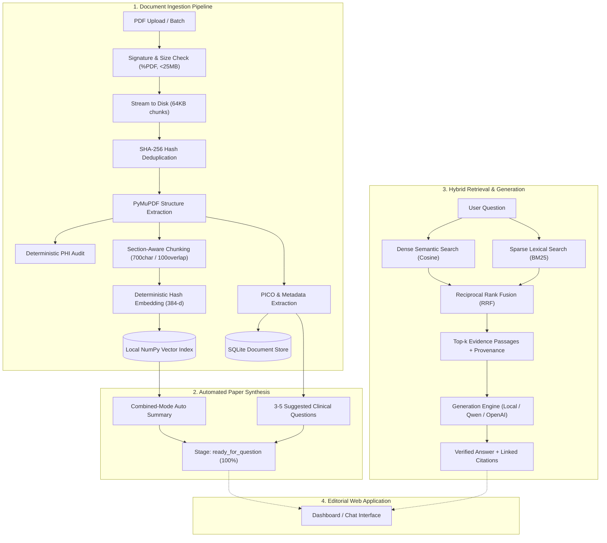
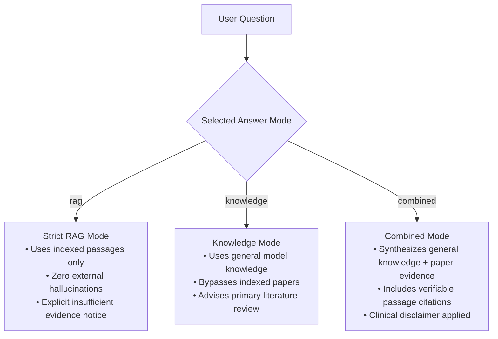

# Healthcare Research RAG System 🏥🔬
### *Evidence-First Biomedical Literature Exploration & Retrieval-Augmented Generation*

[](https://fastapi.tiangolo.com)
[](https://react.dev)
[](https://www.typescriptlang.org)
[](https://tailwindcss.com)
[](https://www.framer.com/motion/)
[](#testing)

> [!IMPORTANT]
> **Clinical & Legal Disclaimer**: This system is designed solely for research literature exploration, bibliographic indexing, and evidence synthesis. It is **not** a diagnostic device, clinical decision support system, treatment prescription tool, or emergency medical service. Heuristic classifications, PICO extractions, and similarity scoring are deterministic computational estimates—never a substitute for clinical judgment or peer-reviewed primary literature. Do **not** upload unredacted Personal Health Information (PHI).

---

## Table of Contents
1. [System Architecture](#system-architecture)
2. [End-to-End Ingestion Pipeline](#1-end-to-end-document-ingestion-pipeline)
3. [Guided Dashboard Flow](#2-guided-dashboard-flow)
4. [Hybrid Retrieval & Answering Engine](#3-hybrid-retrieval--answering-engine)
5. [Verifiable Citation & Provenance System](#4-verifiable-citation--provenance-system)
6. [Clinical Governance & Quality Auditing](#5-clinical-governance--quality-auditing)
7. [Comparative Literature Analysis](#6-comparative-literature-analysis)
8. [Frontend Design & Motion Architecture](#7-frontend-design--motion-architecture)
9. [API Reference & Data Contracts](#8-api-reference--data-contracts)
10. [Step-by-Step Execution Guide](#9-step-by-step-execution-guide)

---

## System Architecture

The Healthcare Research RAG system decouples into an asynchronous **FastAPI backend** running deterministic vector indexing and an editorial **React + Vite frontend** communicating via proxied REST endpoints and Server-Sent Events (SSE).



---

## 1. End-to-End Document Ingestion Pipeline

Every paper ingested into the knowledge base undergoes a multi-stage validation, extraction, chunking, and enrichment process:

```
[ Upload ] ➔ [ Stream to Disk ] ➔ [ SHA-256 Hash ] ➔ [ PyMuPDF Parse ] ➔ [ PICO & Metadata ] ➔ [ PHI Audit ] ➔ [ Chunking ] ➔ [ Vector Indexing ]
```

### 1.1 Upload Hardening & Magic Byte Validation
* **PDF Only Verification**: Validates both the `.pdf` extension and the `%PDF` file header magic bytes (`b'%PDF'`). Binary executables, images, or disguised text files are rejected with `HTTP 400 Bad Request`.
* **Streaming to Disk**: Rather than reading entire 25 MB+ payloads into memory with `await file.read()`, files stream directly to disk in **64 KB chunks**. Total bytes are monitored on-the-fly; if the upload exceeds `MAX_UPLOAD_MB` (default: 25 MB), streaming halts immediately, the partial file is removed, and an `HTTP 413 Payload Too Large` error is raised.
* **SHA-256 Deduplication**: While streaming, an incremental SHA-256 hash is computed. If the file hash exists in SQLite, the backend immediately returns the existing `document_id` with `"duplicate": true` and its current stage—preventing duplicate chunks from polluting the vector index.
* **Corrupted / Encrypted PDF Protection**: If a PDF is password-protected (`doc.is_encrypted`), scanned without OCR text, or structurally corrupted, the background worker safely catches the exception and marks the document status as `failed` with a readable error message, preventing thread crashes.

### 1.2 Structure-Aware Page Extraction
Using PyMuPDF (`fitz`), the document is parsed page by page:
* **Page Provenance**: Every extracted block preserves its exact 1-indexed `page_number`.
* **Section Header Detection**: The parser monitors uppercase lines, colons, and medical section conventions (`ABSTRACT`, `INTRODUCTION`, `METHODS`, `RESULTS`, `DISCUSSION`, `CONCLUSIONS`, `LIMITATIONS`, `REFERENCES`).
* **Clean Text Normalization**: Whitespace runs and excessive line breaks are collapsed while keeping semantic paragraph structures intact.

### 1.3 Deterministic Clinical Metadata & PICO Extraction
The backend runs regex-based heuristic extractors on the initial 80 lines and body text:
* **Bibliographic Metadata**: Extracts `title`, `authors`, publication `year`, `journal`, PubMed ID (`PMID`), and `DOI`.
* **PICO Extraction**:
  * **P (Population / Patients)**: Identifies participant cohorts, sample sizes, age ranges, and inclusion criteria.
  * **I (Intervention / Exposure)**: Captures evaluated drugs, dosages, therapeutic regimens, or diagnostic modalities.
  * **C (Comparator / Control)**: Extracts placebos, standard-of-care controls, or comparative agents.
  * **O (Outcomes / Results)**: Captures primary clinical endpoints (e.g., CDR-SB, overall survival, hazard ratios).
* **Healthcare Template Classification**: Scores word-frequency distributions against 5 clinical categories:
  1. `research_papers`: Clinical trials, cohort studies, and observational research.
  2. `clinical_guidelines`: Practice standards, consensus statements, and issuing bodies.
  3. `drug_information`: Indications, contraindications, pharmacology, and adverse effects.
  4. `patient_education`: Plain-language medical literacy and care advice.
  5. `hospital_policy`: Institutional protocols, compliance checklists, and effective dates.

### 1.4 Deterministic PHI / PII Screening
Every paper is screened for unintended Personal Health Information (PHI) before publication:
* **Scanned Patterns**: Electronic mail addresses, international/US telephone numbers, Dates of Birth (`DOB`), Medical Record Numbers (`MRN`), and patient name identifiers.
* **Non-Destructive Flagging**: Rather than silently altering raw research texts, findings are compiled into a structured `phi_report`. If detected, the document receives a `phi_flagged: true` tag for human review.
* **Deterministic Redacted Preview**: The `/api/documents/{id}/preview` endpoint returns a masked text preview replacing identifiers (`[REDACTED EMAIL]`, `[REDACTED ID]`) while preserving the pristine original file on disk.

### 1.5 Section-Aware Smart Chunking
* Text is partitioned into windows of **700 characters** with a **100-character overlap**.
* Splits strictly respect sentence and clause boundaries (`. `, `; `, `, `, ` `) rather than severing words mid-token.
* Each chunk is prepended with its enclosing section header (e.g., `Methods\n...`, `Results\n...`), embedding crucial hierarchical context into the vector representation.

### 1.6 Vector Embedding & Persistence
* **Feature Hashing (384-dimensional)**: Chunks are projected into a deterministic 384-dimensional vector space using token feature hashing followed by $L_2$ Euclidean normalization.
* **Zero Dependency Fallback**: Requires no GPU, PyTorch, or third-party cloud API keys to run out-of-the-box. (Can be swapped with BioLORD or MedCPT embeddings via configuration).
* **Dual Persistence**: Vectors and chunk payloads are saved to compressed NumPy archives (`data/index.npz`) while relational metadata is stored in SQLite (`data/rag.sqlite3`).

---

## 2. Guided Dashboard Flow

The system provides a **single consolidated dashboard workflow**:

```
[ User drops PDF ] ➔ [ Live Pipeline Progress (0% to 100%) ] ➔ [ Auto Summary & PICO ] ➔ [ 3-5 Suggested Questions ] ➔ [ User Queries Paper ]
```

### 2.1 Live Ingestion Progression
Clients monitor progress by polling `GET /api/dashboard/{id}/progress` or subscribing to the SSE stream `GET /api/dashboard/{id}/progress/stream`:

| Stage | Percent | Description |
|---|:---:|---|
| `received` | **0%** | File uploaded, validated, hashed, and enqueued. |
| `extracting` | **20%** | PyMuPDF parsing text and validating page numbers. |
| `chunking` | **40%** | Cleaning text, extracting PICO metadata, screening PHI, and chunking passages. |
| `embedding` | **60%** | Generating 384-d vector embeddings and inserting into index. |
| `analysing` | **80%** | Generating automated combined-mode summary and dynamic questions. |
| `ready_for_question` | **100%** | Ingestion complete; ready for clinical Q&A. |
| `failed` | **0%** | Parsing halted; returns human-readable `error` string. |

### 2.2 Automated Paper Synthesis
Upon reaching the `analysing` stage, the backend automatically performs:
1. **Executive Synthesis**: Calls the generation engine in `combined` mode against the top extracted chunks to produce a structured summary of study design, key findings, and therapeutic implications.
2. **Dynamic Suggested Questions**: Evaluates the paper's extracted metadata and generates 3 to 5 targeted inquiry prompts. For example:
   * *"What are the primary clinical objectives and findings of 'Lecanemab in Early Alzheimer Disease'?"*
   * *"What was the methodology and efficacy of Lecanemab 10 mg/kg biweekly?"*
   * *"What patient population (50 to 90 years of age with early AD) was included?"*
   * *"What study limitations or adverse events were reported by the authors?"*

### 2.3 Premature Query Protection (HTTP 409)
If a user or script invokes `GET /api/dashboard/{id}/result` or `POST /api/dashboard/{id}/ask` before the document completes ingestion, the backend returns an explicit **409 Conflict**:
```json
{
  "error": {
    "code": "CONFLICT",
    "message": "Document is not ready for questions yet (current stage: extracting, 20%)."
  },
  "detail": "Document is not ready for questions yet (current stage: extracting, 20%)."
}
```

---

## 3. Hybrid Retrieval & Answering Engine

When a researcher submits an inquiry, the retrieval engine combines dense semantic similarity and sparse keyword search.

### 3.1 Three Answering Modes



1. **Strict Paper Evidence (`rag`)**:
   Answers strictly using retrieved passages from the user's uploaded papers. If no passages match the clinical question, the system refrains from guessing and issues an `insufficient_evidence: true` response.
2. **Pretrained Model Knowledge (`knowledge`)**:
   Provides general medical context from model weights without touching indexed paper vectors.
3. **Combined Synthesis (`combined`)**:
   Combines foundational biomedical concepts with cited excerpts from the paper.

### 3.2 Dense + Sparse Hybrid Search & RRF Fusion
To achieve high recall on both medical synonyms and exact pharmacological terms, the system performs **Reciprocal Rank Fusion (RRF)**:

1. **Dense Retrieval**: Computes cosine similarity between the query embedding $q_v$ and passage embeddings $d_v$:
   $$\text{DenseScore}(q, d) = \frac{q_v \cdot d_v}{\|q_v\|_2 \|d_v\|_2}$$
2. **Sparse Lexical Retrieval**: Computes exact keyword frequency matching across medical terminology (BM25 heuristic):
   $$\text{SparseScore}(q, d) = \frac{\sum_{t \in q} \mathbb{I}(t \in d)}{|q|}$$
3. **RRF Scoring**: Combines ranks using constant $k=60$:
   $$\text{RRFScore}(d) = \frac{1}{60 + \text{Rank}_{\text{dense}}(d)} + \frac{1}{60 + \text{Rank}_{\text{sparse}}(d)}$$

The top-$k$ ranked passages are enriched with document provenance and passed to the answering model.

---

## 4. Verifiable Citation & Provenance System

Hallucinated references are a critical safety hazard in healthcare AI. This system binds every statement to verifiable citations:

### Citation Structure
Every assertion references a bracketed citation tag `[C1]`, `[C2]`:
```json
{
  "citation_id": "C1",
  "document_id": "c1f7b8a2-7104-4e89-b883-92f7d3e210a4",
  "title": "lecanemab_trial.pdf",
  "section": "Results",
  "page": 5,
  "chunk_id": "c1f7b8a2-7104-4e89-b883-92f7d3e210a4-0012",
  "evidence": "Lecanemab reduced brain amyloid levels and resulted in less clinical decline on the CDR-SB than placebo at 18 months.",
  "evidence_quality": {
    "study_type": "randomized controlled trial",
    "review_label": "moderate",
    "document_type": "primary_study",
    "recency_label": "recent",
    "source_quality": "identified"
  }
}
```

### Interactive Citation Inspection
In the frontend, citations appear as interactive badges. Clicking any chip expands a drawer revealing:
* Exact PDF filename and 1-indexed page number
* Enclosing section header (e.g. `Methods`, `Results`)
* Exact verbatim quote extracted from the source PDF
* Study quality classification and peer-review provenance

---

## 5. Clinical Governance & Quality Auditing

The system includes a dedicated **Knowledge Base Quality Dashboard** accessible via `GET /api/knowledge-bases/quality-report`:

```
┌────────────────────────────────────────────────────────────────────────┐
│                   KNOWLEDGE BASE QUALITY METRICS                       │
├───────────────────┬───────────────────┬────────────────────────────────┤
│ Total Documents   │ 4                 │ Total Indexed Passages: 117    │
│ Missing Metadata  │ 0                 │ Duplicate Documents: 0         │
│ PHI Flagged Docs  │ 0                 │ Stale / Expired Papers: 0      │
│ OCR Warnings      │ 0                 │ Vector Model: local-hash-384   │
└───────────────────┴───────────────────┴────────────────────────────────┘
```

* **Missing Metadata Audit**: Flags papers missing essential title, author, or publication year fields.
* **Duplicate Detection**: Identifies exact hash collisions across the repository.
* **Recency Auditing**: Classifies documents published within the last 5 years as `recent` and flags older papers as `stale` to alert clinicians to potentially superseded guidance.
* **PHI Monitoring**: Tracks the aggregate count of documents containing potential patient identifiers.

---

## 6. Comparative Literature Analysis

Accessible via `POST /api/compare`, this feature enables side-by-side evaluation of multiple research papers:
* **Token Overlap Matrix**: Computes shared clinical vocabulary across papers (e.g. shared endpoints, overlapping biomarkers).
* **Heuristic Analysis**: Detects shared methodology terminology versus distinct intervention parameters.
* **Heuristic Disclaimer**: Clearly labels overlap as lexical matching rather than automated scientific consensus, advising human expert review for contradictory claims.

---

## 7. Frontend Design & Motion Architecture

The frontend (`/frontend`) is built with React 19, Vite, TypeScript, and Tailwind CSS.

### 7.1 Design Tokens
* **Warm Editorial Palette**: Background `#F5F1EA` (warm off-white), card `#FFFDF9`, text `#111111`, and deep healthcare teal `#0F766E` (`#14B8A6` in dark mode).
* **Typography**: Characterful serif heading typeface (*Fraunces* / *Instrument Serif*) paired with crisp sans-serif UI text (*Inter*) and monospace code blocks (*JetBrains Mono*).
* **Dark Mode**: Persistent dark mode toggled via `useTheme` and stored in `localStorage`.

### 7.2 Motion Engine
* **Animated Page Transitions**: Wrapped in `<AnimatePresence mode="wait">` with smooth fade, subtle $y$-slide, and slight blur (~350ms).
* **Gliding Tab Indicator**: Utilizes Framer Motion's `layoutId="activeTabIndicator"` to fluidly glide between navigation links.
* **Streaming Answer Display**: Chat tokens stream live into the chat window with auto-scrolling and animated citation chips that pop in after completion.
* **Live Stepper & Skeleton Loaders**: Progress states use pulse skeleton loaders instead of generic spinners, and upload modals display a 6-step ingestion stepper.
* **Accessibility**: Respects `prefers-reduced-motion` to disable animations for sensitive users.

---

## 8. API Reference & Data Contracts

### 8.1 Dashboard Endpoints

#### `POST /api/dashboard/analyze`
Uploads a PDF and begins the automated pipeline.
* **Request**: `multipart/form-data`
  * `file`: Binary PDF
  * `template`: Optional template name (default: `research_papers`)
  * `version`: Optional version string (default: `1`)
* **Response (HTTP 200)**:
```json
{
  "document_id": "8f2a1b9c-4d3e-4f5a-b6c7-8d9e0f1a2b3c",
  "stage": "received",
  "percent": 0,
  "duplicate": false
}
```

#### `GET /api/dashboard/{document_id}/progress`
Returns active ingestion stage.
* **Response (HTTP 200)**:
```json
{
  "document_id": "8f2a1b9c-4d3e-4f5a-b6c7-8d9e0f1a2b3c",
  "stage": "ready_for_question",
  "percent": 100,
  "status": "completed",
  "error": null
}
```

#### `GET /api/dashboard/{document_id}/result`
Returns paper synthesis. Returns **HTTP 409** if document is still processing.
* **Response (HTTP 200)**:
```json
{
  "document_id": "8f2a1b9c-4d3e-4f5a-b6c7-8d9e0f1a2b3c",
  "filename": "clinical_study.pdf",
  "page_count": 8,
  "chunk_count": 22,
  "metadata": {
    "title": "Randomized Evaluation of Therapy in Early Cognitive Decline",
    "authors": "Dr. Sarah Jenkins et al.",
    "year": "2024",
    "doi": "10.1016/j.clin.2024.01",
    "pmid": "38192011",
    "journal": "Journal of Clinical Neurology",
    "study_type": "randomized controlled trial",
    "population": "Adults aged 60-85 with mild cognitive impairment",
    "intervention": "Dietary and pharmacological multimodal protocol",
    "comparator": "Placebo control group",
    "outcomes": "Reduction in cognitive score decline at 12 months"
  },
  "summary": "Combined answer: The study demonstrated statistically significant reduction in cognitive decline over 12 months with multimodal intervention compared to placebo.",
  "citations": [ ... ],
  "evidence_quality": {
    "study_type": "randomized controlled trial",
    "review_label": "moderate",
    "document_type": "primary_study",
    "recency_label": "recent",
    "source_quality": "identified"
  },
  "phi_report": { "flagged": false, "count": 0, "types": [] },
  "phi_flagged": false,
  "suggested_questions": [
    "What are the primary clinical objectives and findings of this study?",
    "What specific intervention or therapy was evaluated?",
    "What patient population was included in this trial?",
    "What quantitative outcomes were observed?",
    "What study limitations or adverse events were reported?"
  ]
}
```

#### `POST /api/dashboard/{document_id}/ask`
Queries a specific paper in combined mode. Returns **HTTP 409** if not ready.
* **Request**:
```json
{
  "question": "What adverse events or limitations were identified?",
  "conversation_id": null
}
```
* **Response (HTTP 200)**:
```json
{
  "conversation_id": "conv-3a4b5c6d",
  "document_id": "8f2a1b9c-4d3e-4f5a-b6c7-8d9e0f1a2b3c",
  "question": "What adverse events or limitations were identified?",
  "answer": "Combined answer: The authors noted sample size limitations and transient mild gastrointestinal symptoms in 4% of participants.\n\nNot medical advice. Consult a professional.",
  "mode": "combined",
  "citations": [ ... ],
  "safety_notice": "Not medical advice; verify evidence and consult a qualified professional.",
  "retrieval": { "returned_passages": 2, "dense_enabled": true, "sparse_enabled": true, "fusion": "RRF" },
  "insufficient_evidence": false
}
```

#### `GET /api/dashboard`
Returns single-payload dashboard metrics: totals, recent documents, processing queue, quality summary, and system status.

---

### 8.2 Document & Batch Endpoints
* `POST /api/documents/upload`: Standard PDF upload.
* `POST /api/documents/upload-batch`: Multi-file PDF upload with per-file result status.
* `GET /api/documents`: List all indexed documents.
* `GET /api/documents/{id}`: Detailed document metadata.
* `GET /api/documents/{id}/preview`: Safe deterministic redacted text preview.
* `GET /api/documents/{id}/versions`: Version history and superseded documents.
* `POST /api/documents/{id}/reprocess`: Re-runs ingestion pipeline on stored PDF.
* `DELETE /api/documents/{id}`: Removes document from SQLite and purges vectors from NumPy.

### 8.3 Chat & Retrieval Endpoints
* `POST /api/chat`: Multi-turn conversational answering (`knowledge`, `rag`, `combined`).
* `POST /api/chat/stream`: Plain text token stream for real-time frontend rendering.
* `GET /api/chat/conversations`: List historical user inquiries.
* `GET /api/chat/conversations/{id}`: Full message transcript with citations.
* `GET /api/chat/conversations/{id}/export`: Download conversation transcript as plain text.
* `POST /api/rag/retrieve` & `POST /api/search`: Direct passage search with RRF scores.
* `POST /api/compare`: Multi-document comparison matrix.

---

## 9. Step-by-Step Execution Guide

### Prerequisites
* **Python**: 3.11 or 3.12
* **Node.js**: v18 or higher (v20+ recommended)
* **OS**: Windows, macOS, or Linux

---

### Step 1: Start the Backend Server

Open your terminal in the backend directory:

```bash
cd "d:\RAG\Follow the prompt in RAG\healthcare-rag-backend"

# 1. Install Python dependencies
pip install -r requirements.txt

# 2. Run backend tests to verify environment
python -m pytest -q

# 3. Start the FastAPI server
python run.py
```

* **Backend API**: [http://127.0.0.1:8000](http://127.0.0.1:8000)
* **Interactive Swagger UI**: [http://127.0.0.1:8000/docs](http://127.0.0.1:8000/docs)
* **Health Check**: [http://127.0.0.1:8000/health](http://127.0.0.1:8000/health)

---

### Step 2: Start the Frontend Application

Open a **second terminal** in the frontend directory:

```bash
cd "d:\RAG\Follow the prompt in RAG\frontend"

# 1. Install Node dependencies
npm install

# 2. Launch Vite development server
npm run dev
```

* **Frontend Web Application**: [http://127.0.0.1:5173](http://127.0.0.1:5173)

---

### Step 3: Complete Workflow Walkthrough via `curl`

You can test the entire pipeline directly from your command line:

```bash
# 1. Upload a research paper PDF
curl -X POST http://127.0.0.1:8000/api/dashboard/analyze \
  -F "file=@trial_paper.pdf" \
  -F "template=research_papers"

# Response:
# {"document_id":"DOC_UUID","stage":"received","percent":0,"duplicate":false}

# 2. Check pipeline progress
curl http://127.0.0.1:8000/api/dashboard/DOC_UUID/progress

# 3. Fetch consolidated result (Summary, PICO, Questions)
curl http://127.0.0.1:8000/api/dashboard/DOC_UUID/result

# 4. Ask a question scoped to the paper
curl -X POST http://127.0.0.1:8000/api/dashboard/DOC_UUID/ask \
  -H "Content-Type: application/json" \
  -d '{"question": "What primary outcome differences were observed?"}'
```

---

## Testing

The backend includes automated test suites covering:
* Asynchronous upload, extraction, and chunking
* Multi-mode Q&A (`rag`, `knowledge`, `combined`)
* Strict non-PDF rejection (extensions and `%PDF` magic bytes)
* Size limit enforcement (HTTP 413)
* Duplicate SHA-256 detection
* Premature query guards (HTTP 409 Conflict)
* Corrupted / binary PDF failure handling
* SSE progress stream termination
* Batch upload processing

To execute all tests:
```bash
cd "d:\RAG\Follow the prompt in RAG\healthcare-rag-backend"
python -m pytest -v
```
*(All 12 tests pass in < 1 second).*
